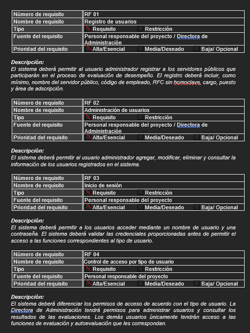
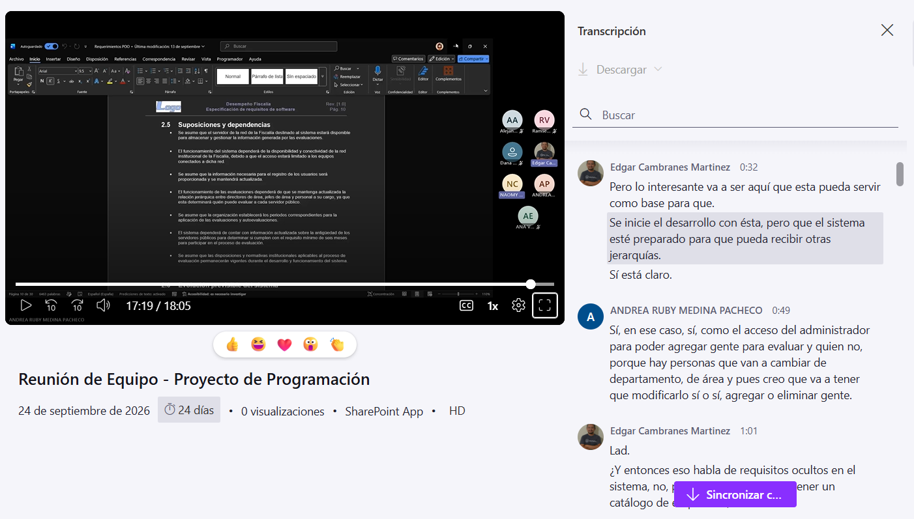
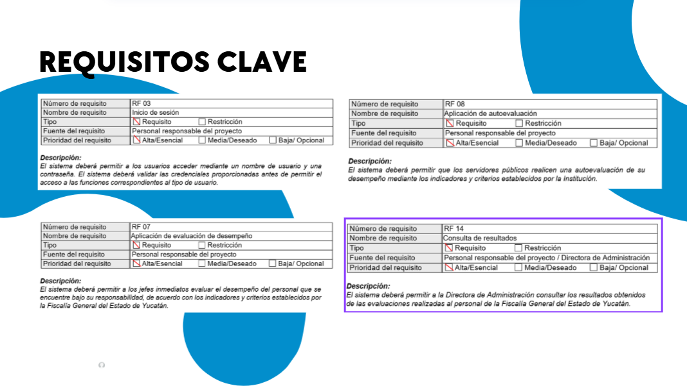

# Sprint 01 - Análisis y definición de requerimientos

### Objetivo
Establecer los requerimientos iniciales del sistema SEDFGEY y definir el alcance generral del proyecto.

### Actividades realizadas
- Identificación y elaboración de requerimientos base del sistema.
- Elaboraión inicial de la documentación de requerimientos.
- Reunión mediante videollamada para revisar y discutir la propuesta inial.
- Revisión de los requerimientos establecidos.
- Modificación de algunos requerimientos.
- Ajuste del alcance del proyecto para delimitar las fucionalidades a desarrollar.

### Resultados obtenidos
- Requerimientos revisados y ajustados
- Alcance del proyecto delimitado.
- Base documental para iniciar la segunda entrega de la etapa de desarrollo.

## Evidencias
- Captura de la documentación inicial de requerimientos.

- Captura de la videollamada.

- Comparación de los requerimientos antes y después de los ajustes.
