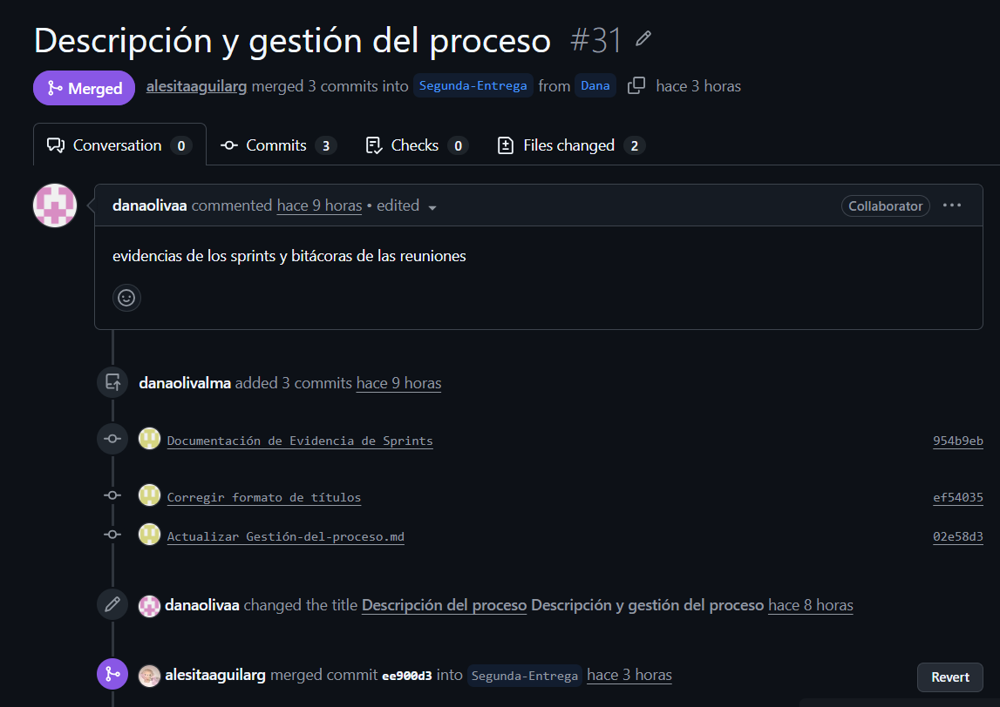
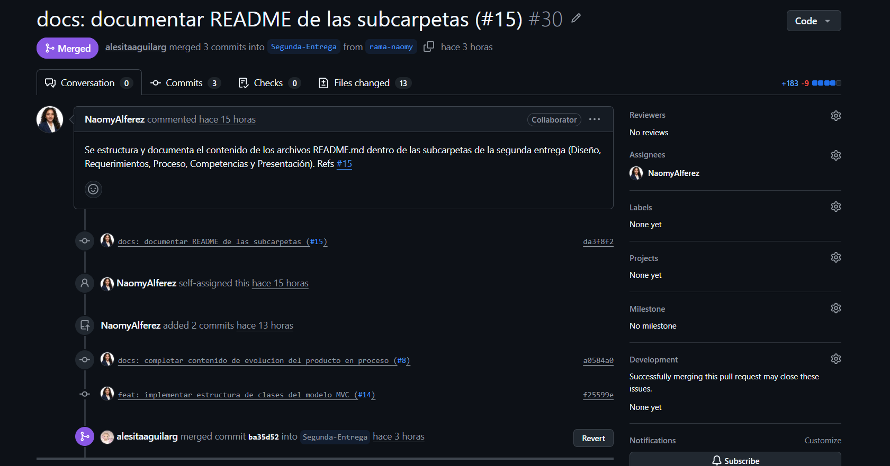
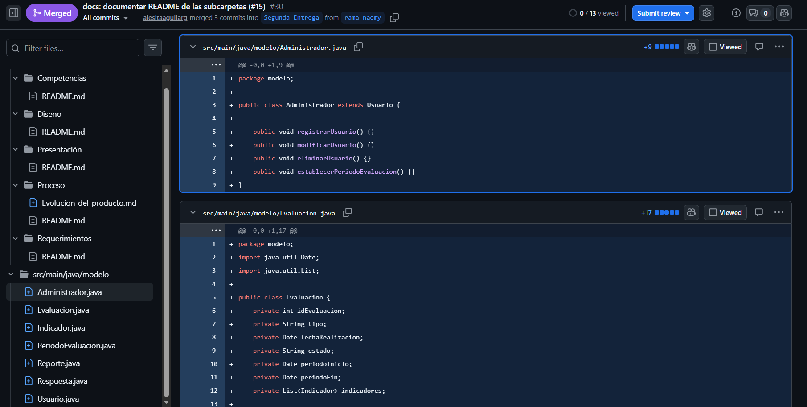

# Sprint 02 - Organización e iniio del desarrollo

### Objetivo 
Iniciar la implementación del sistema SEDFGEY tomando como referencia los requerimientos y el alcance definido durante el sprint 01.

### Actividades realizadas
- Inidicio del desarrollo del código del proyecto.
- Organización y estruturación del repositorio de Github.
- Revisión y clasificación de los archivos y documentos existentes.
- Organización delas ramas de trabajo.

### Resultados esperados
- Repositorio con una estructura más organizada.
- Inicio de la implementación del sistema.
- Mayor claridad en la distribución de archivos y actividades de desarrollo.

## Evidencias
- Commits realizados durante el sprint.

- Captura de los archivos de código desarrollados.

- Pull Requests.
