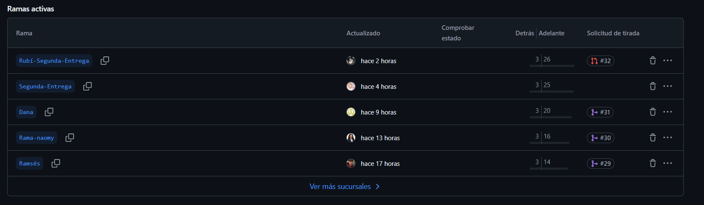
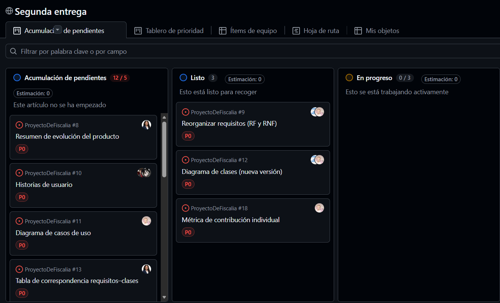
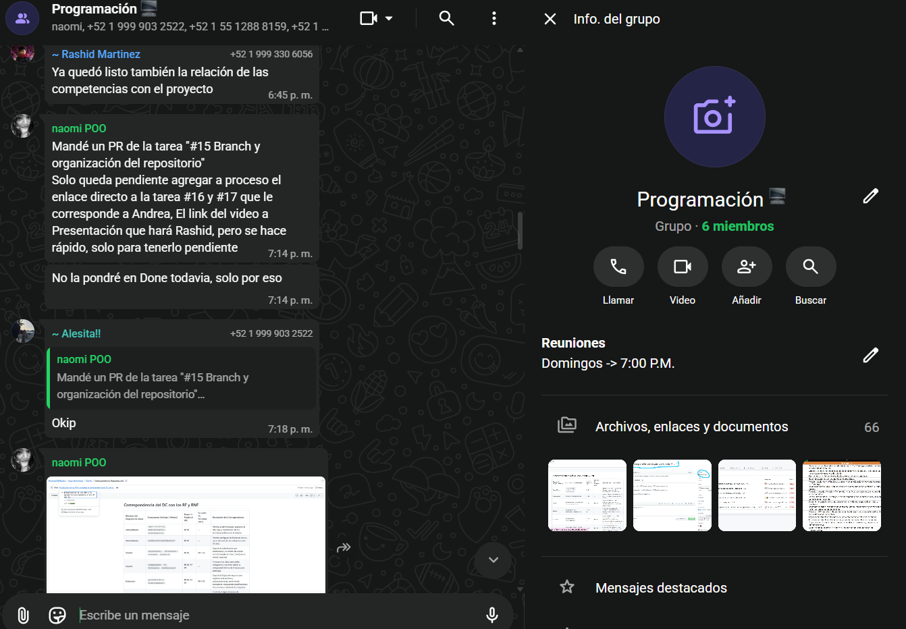

# Competenias Gnenéricas

### Proyecto SEDFGEY
**Introducción**

Durante el desarrollo del Sistema de Evaluación del Desempeño de la Fiscalía General del Estado de Yucatán (SEDFGEY) para la segunda entrega, se pusieron en práctica distintas competencias genéricas que contribuyeron a la organización, coordinación y desarrollo del proyecto.

Estas competencias representan habilidades transversales aplicadas durante el trabajo colaborativo, la comunicación entre los integrantes, la organización de actividades, la resolución de problemas y el cumplimiento de los compromisos establecidos.

En los siguientes apartados se describen las competencias desarrolladas y su aplicación dentro del proyecto, acompañadas de evidencias que respaldan su implementación.

## Trabajo colaborativo mediante GitHub

Durante el desarrollo del proyecto SEDFGEY se utilizó Git y GitHub como herramientas para organizar y coordinar las aportaciones de los integrantes del equipo. Cada integrante trabaja en una rama independiente, donde desarrolla y registra los avances correspondientes a su responsabilidad.

Posteriormente, los cambios se comparten mediante el repositorio remoto, lo que permite centralizar las contribuciones y mantener un seguimiento de las modificaciones realizadas al proyecto.

## Cumplimiento de plazos

La organización del trabajo mediante sprints permitió dividir el desarrollo del proyecto en etapas, establecer actividades y dar seguimiento a los avances de cada integrante. Asimismo, el uso de herramientas como GitHub facilitó el registro de las contribuciones y la consulta del progreso del proyecto.

Esta organización contribuyó a mantener un seguimiento de las responsabilidades individuales y del trabajo colectivo, favoreciendo la entrega progresiva de los productos y documentos correspondientes a cada etapa.

## Resolución de problemas

Para atender estas situaciones, se utilizó un chat grupal como medio de comunicación y colaboración, en el cual los integrantes podían compartir sus dudas, plantear dificultades, intercambiar ideas y proponer posibles soluciones.

Este espacio permitió mantener una comunicación constante, resolver inquietudes relacionadas con las actividades del proyecto y llegar a acuerdos para continuar con el desarrollo del trabajo.

