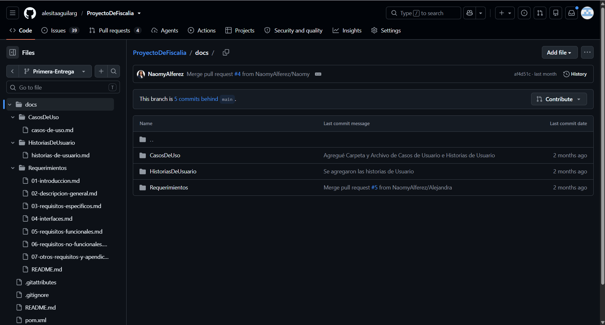
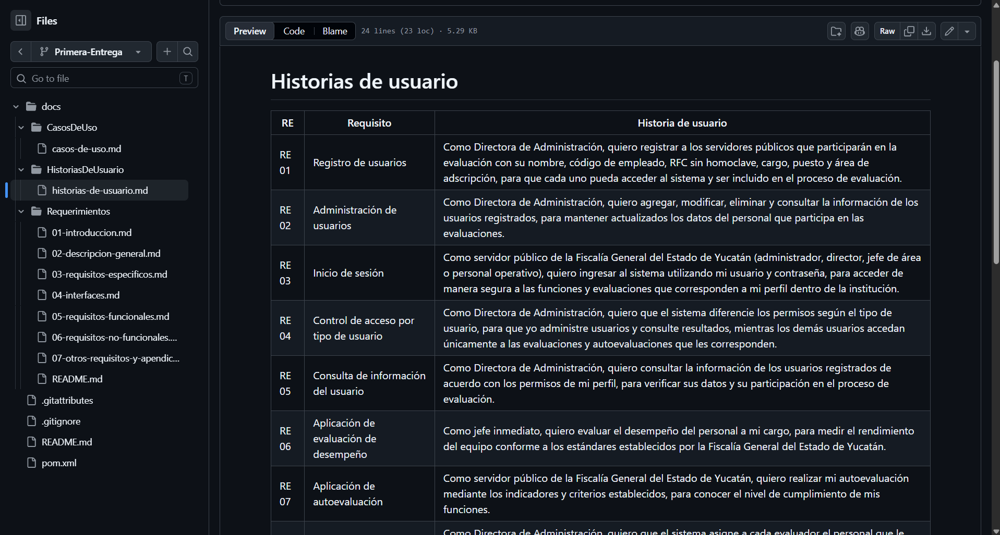
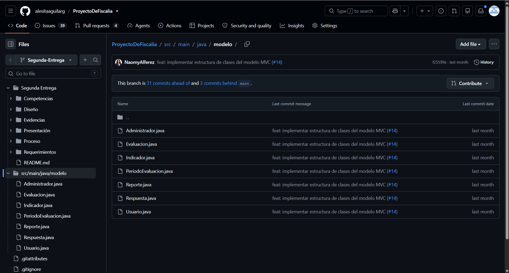
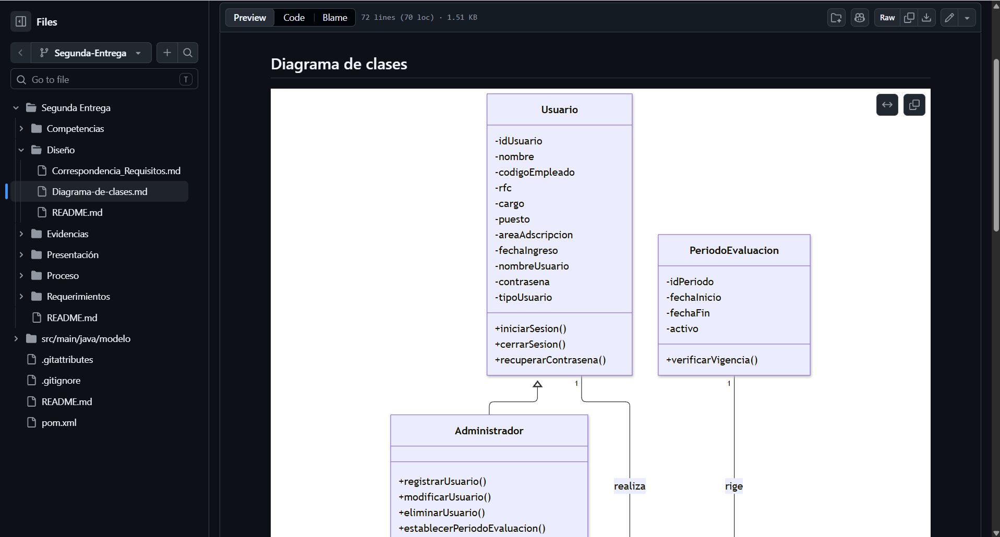
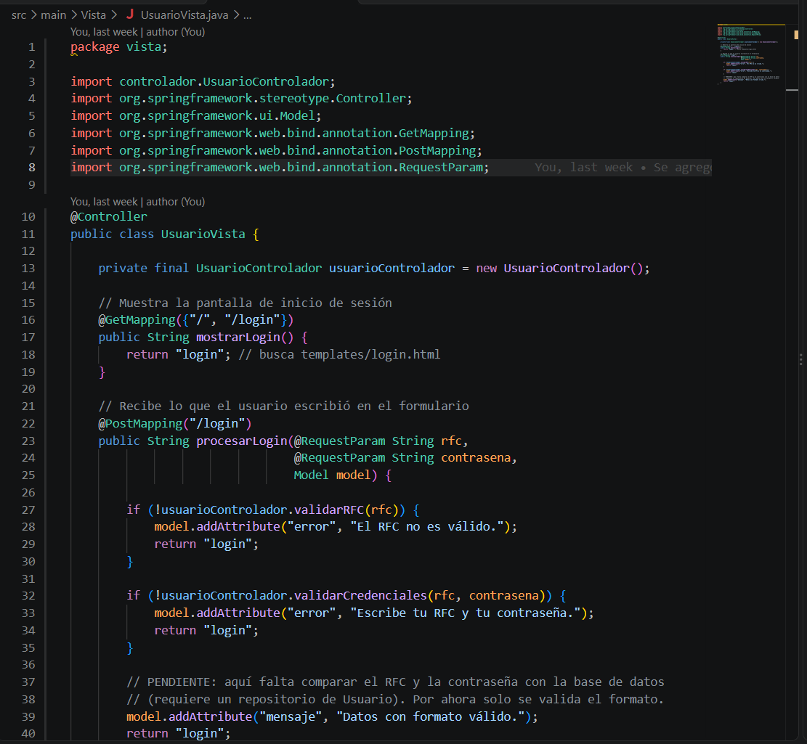
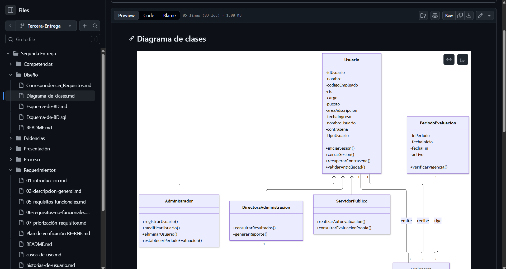
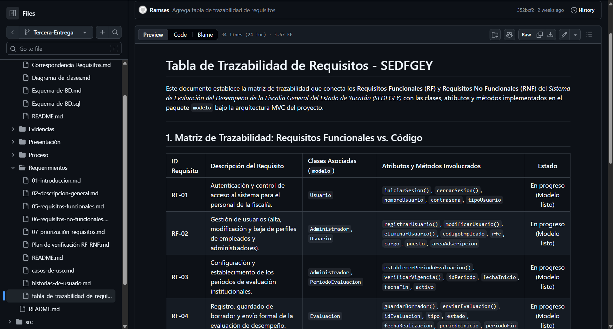

# Evolución del Producto: Comparativa de Entregas (SEDFGEY)

Este documento presenta el análisis detallado de la evolución técnica, documental, arquitectónica y metodológica del **Sistema de Evaluación del Desempeño de la Fiscalía General del Estado de Yucatán (SEDFGEY)** a lo largo de sus tres entregas de desarrollo.

---

## 1. Matriz Comparativa General por Entrega

| Dimensión | Primera Entrega (Análisis y SRS) | Segunda Entrega (Diseño UML y Base MVC) | Tercera Entrega (Persistencia, MVC Completo y Verificación) |
| :--- | :--- | :--- | :--- |
| **Ingeniería de Requisitos** | Levantamiento inicial en formato SRS tradicional con 20 requisitos específicos (`RE 01–RE 20`) y 12 requisitos funcionales (`RF 01–RF 12`), sin priorización ni criterios de aceptación formales. | Consolidación a 9 historias de usuario (`RE 01–RE 09`) con criterios de aceptación y 8 requisitos funcionales (`RF 01–RF 08`). Se introduce matriz MoSCoW (`07-priorización-requisitos.md`) y métricas cuantitativas en RNF. | Incorporación de manejo de excepciones por historia de usuario (`historias-de-usuario.md`), matriz de trazabilidad contra código Java (`tabla_de_trazabilidad_de_requisitos_sedfgey.md`) y `Plan de verificación RF-RNF.md`. |
| **Modelado y Diseño** | Enfoque conceptual de aplicación web sin diagramas UML formales ni modelo de datos definido. | Creación del Diagrama de Casos de Uso (3 actores: Administrador, Director, Fiscales) y Diagrama de Clases v1 con 7 entidades (`Usuario`, `Administrador`, `Evaluacion`, `PeriodoEvaluacion`, `Indicador`, `Respuesta`, `Reporte`) y tabla `Correspondencia_Requisitos.md`. | Evolución a Diagrama de Clases v2 (`Cambios_DC.md`): se agregan las subclases `DirectoraAdministracion` y `ServidorPublico`, se divide la relación con `Evaluacion` en `emite`/`recibe`, se añade `ponderacion` en `Indicador` y se diseña el esquema relacional MySQL (`Esquema-de-BD.sql`). |
| **Arquitectura y Código (`src/`)** | Sin código fuente; únicamente documentación de especificaciones. | Inicialización de proyecto Maven (`pom.xml`), `.gitignore` y creación del paquete `src/main/java/modelo` con las 7 clases base del dominio en Java. | Completitud de las capas del patrón **MVC**: se implementa el paquete `src/main/java/controlador` (`UsuarioControlador.java`, `EvaluacionControlador.java`, `PeriodoEvaluacionControlador.java`, `ReporteControlador.java`) y el paquete `src/main/Vista` (`UsuarioVista.java`). |
| **Gestión y Proceso** | Trabajo documental lineal sin división formal de sprints ni métricas de aporte individual. | Adopción de Scrum en 4 sprints semanales (8–31 oct), tablero Kanban en GitHub Projects, bitácoras (`Gestión-del-proceso.md`) y métrica equitativa de contribución individual (42 pts / 16.67% por integrante). | Retrospectiva de mejora continua, replanteamiento de 4 sprints (2–28 nov) con 31 tareas puntuadas e indicadores de rúbrica (`Bitacora-Sprint1-TE.md`, `Bitacora-Sprint2-TE.md`), flujo de ramas individuales y Pull Requests para integración. |

---

## 2. Desglose de Cambios

### 2.1 Primera Entrega: Levantamiento de Especificaciones (SRS Base)
En esta etapa inicial se estableció el marco teórico, normativo y funcional del sistema SEDFGEY siguiendo la estructura estándar de una Especificación de Requisitos de Software (SRS).

* **¿Qué se construyó en esta entrega?**
  1. **Contexto institucional (`01-introduccion.md` y `02-descripcion-general.md`):** Se definió el alcance del sistema para servidores públicos de la Fiscalía General del Estado de Yucatán (20 a 60 años), identificando los roles operativos (Administrador, Directores de área, Jefes de área y Personal operativo) y las restricciones normativas (acceso limitado a red institucional, periodo máximo de 30 días, antigüedad mínima de 6 meses, código de empleado numérico y RFC sin homoclave).
  2. **Especificación extensa de requisitos (`03-requisitos-especificos.md` y `05-requisitos-funcionales.md`):** Se redactaron 20 requisitos específicos (`RE 01` a `RE 20`) y 12 requisitos funcionales (`RF 01` a `RF 12`) detallando entradas, procesamiento y salidas de cada módulo, además de los requisitos de interfaces (`04-interfaces.md`) y atributos no funcionales (`06-requisitos-no-funcionales.md`).
  3. **Limitaciones detectadas al cierre:** No existía separación por capas de software, diagramas UML de comportamiento/estructura, modelo de base de datos ni código ejecutable; además, secciones como `07-otros-requisitos-y-apendices.md` quedaron como plantillas pendientes.

* ** Evidencias de la Primera Entrega:**
  * **Evidencia 1.1 — Estructura documental inicial del SRS:**
  
  * **Evidencia 1.2 — Especificación inicial de requisitos:** 
   

---

### 2.2 Segunda Entrega: Reestructuración, Modelado UML y Paquete `modelo`
En la transición de la primera a la segunda entrega, el equipo transformó la especificación textual en una arquitectura orientada a objetos, reorganizó el repositorio por áreas de ingeniería y comenzó la codificación en Java.

* **¿Qué cambió respecto a la Primera Entrega?**
  1. **Reorganización del repositorio:** Se abandonó la lista plana de documentos y se estructuró el proyecto en carpetas especializadas: `Competencias`, `Diseño`, `Evidencias`, `Presentación`, `Proceso` y `Requerimientos`, junto con la raíz de proyecto Maven (`pom.xml`, `.gitignore`).
  2. **Depuración y priorización de requisitos:** Se sintetizaron los 20 requisitos originales en **9 historias de usuario con criterios de aceptación verificables** (`RE 01–RE 09`) y **8 requisitos funcionales** (`RF 01–RF 08`), integrando reglas dispersas (como la antigüedad de 6 meses dentro de `RF 01` y `RF 04`). Además, se creó `07-priorización-requisitos.md` aplicando la técnica **MoSCoW** (*Must Have*, *Should Have*, *Could Have*) y se cuantificaron los RNF (tiempos de respuesta $\le$ 3 s, $\le$ 5 s y $\le$ 10 s; disponibilidad del 99%).
  3. **Modelado UML y Trazabilidad:** Se rediseñó el **Diagrama de Casos de Uso** delimitando los actores *Administrador*, *Director* y *Fiscales (47)*, y la **Versión 1 del Diagrama de Clases** con 7 entidades (`Usuario`, `Administrador`, `Evaluacion`, `PeriodoEvaluacion`, `Indicador`, `Respuesta`, `Reporte`), respaldada por `Correspondencia_Requisitos.md`.
  4. **Inicio de codificación en Java (`src/main/java/modelo`):** Se implementaron las 7 clases del paquete `modelo` con sus atributos privados, constructores y métodos base.
  5. **Gestión Scrum y métricas:** Se implementó el trabajo en 4 sprints semanales con tablero de Issues en GitHub, bitácoras (`Gestión-del-proceso.md`) y la `Métrica-contribución-ind.md` (42 puntos totales distribuidos equitativamente al 16.67% por integrante).

* ** Evidencias de la Segunda Entrega:**
  * **Evidencia 2.1 — Reorganización de carpetas y código `modelo` en Java:** 
  
  * **Evidencia 2.2 — Diagrama de Casos de Uso y Diagrama de Clases v1:** 
   
---

### 2.3 Tercera Entrega: Refinamiento de Diseño, Base de Datos, MVC Completo y Verificación
En la tercera etapa el sistema evolucionó hacia una arquitectura multicapa completa, corrigiendo omisiones de modelado detectadas en la segunda entrega, incorporando persistencia relacional, lógica de validación en controladores, interfaz de usuario en la capa Vista y protocolos formales de verificación.

* **¿Qué cambió respecto a la Segunda Entrega?**
  1. **Evolución del Diagrama de Clases (v1 $\rightarrow$ v2 en `Cambios_DC.md`):**
     * **Especialización de roles por herencia:** Se agregaron las subclases `DirectoraAdministracion` (`consultarResultados()`, `generarReporte()`) y `ServidorPublico` (`realizarAutoevaluacion()`, `consultarEvaluacionPropia()`), pasando de 1 a 3 roles especializados que heredan de `Usuario`.
     * **Segregación de responsabilidades:** La relación `genera` con `Reporte` se transfirió de `Administrador` a `DirectoraAdministracion`, separando la gestión operativa de usuarios/periodos de la consulta confidencial de resultados.
     * **Distinción entre evaluador y evaluado:** La asociación genérica `Usuario -- Evaluacion : realiza` se dividió en dos relaciones explícitas (`emite` y `recibe`), permitiendo representar tanto evaluaciones jerárquicas como autoevaluaciones.
     * **Nuevas reglas en el dominio:** Se incorporó `validarAntigüedad()` directamente en `Usuario` y el atributo `ponderacion` en `Indicador` para calcular calificaciones ponderadas en lugar de promedios simples.
  2. **Diseño de Persistencia Relacional (`Esquema-de-BD.md` y `Esquema-de-BD.sql`):** Se tradujo el diagrama de clases a un modelo entidad-relación y script SQL para MySQL (`sedfgey`) con 6 tablas (`usuario`, `periodo_evaluacion`, `evaluacion`, `indicador`, `respuesta`, `reporte`), implementando herencia en tabla única mediante discriminador `tipo_usuario` con restricciones `CHECK`, contraseñas cifradas (`contrasena_hash`), doble llave foránea en `evaluacion` (`id_usuario_emisor`, `id_usuario_receptor`) e integridad referencial con `ON DELETE CASCADE`.
  3. **Implementación de las capas Controlador y Vista (`src/main`):**
     * **Paquete `src/main/java/controlador`:** Se incorporaron 4 clases nuevas (`UsuarioControlador.java`, `EvaluacionControlador.java`, `PeriodoEvaluacionControlador.java` y `ReporteControlador.java`), implementando las validaciones de negocio (formato numérico de código de empleado, RFC alfanumérico, antigüedad mínima de 6 meses, vigencia de periodos de máximo 30 días y bloqueo de evaluaciones enviadas).
     * **Paquete `src/main/Vista`:** Se agregó la carpeta de interfaz de usuario con `UsuarioVista.java`, completando las tres capas del patrón arquitectónico Modelo-Vista-Controlador.
  4. **Aseguramiento de calidad y trazabilidad completa:**
     * Se amplió `historias-de-usuario.md` añadiendo una cuarta columna de **Excepciones a considerar** (RFC duplicado, usuario inactivo, fallo de conexión a BD, periodos sin datos).
     * Se creó `tabla_de_trazabilidad_de_requisitos_sedfgey.md` mapeando cada `RF` y `RNF` directamente con las clases, atributos y métodos en Java.
     * Se elaboró el `Plan de verificación RF-RNF.md` definiendo métodos formales (casos de prueba estructurados) e informales para validar `RE01–RE20` y `RNF01–RNF11`.
  5. **Mejora en la gestión Scrum:** Tras una retrospectiva el 3 de noviembre sobre la coordinación previa, se estructuraron 4 nuevos sprints (del 2 al 28 de noviembre) con 31 tareas puntuadas e indicadores vinculados directamente a la rúbrica de evaluación, gestionando cada avance en ramas de trabajo e integrándolos mediante Pull Requests.

* ** Evidencias de la Tercera Entreg:**
  * **Evidencia 3.1 — Código de validaciones e interfaz en Java:** 
   
  * **Evidencia 3.2 — Diagrama de Clases v2 y Esquema de Base de Datos:** 
   
  * **Evidencia 3.3 — Matriz de Trazabilidad y Plan de Verificación:**
   

---

## 3. Conclusión de la Evolución

A lo largo de las tres entregas, **SEDFGEY** transitó de una especificación documental inicial (SRS) a una arquitectura de software modular, trazable y validada. En la segunda entrega se establecieron los cimientos orientados a objetos (`modelo`), la priorización MoSCoW y la disciplina de trabajo bajo Scrum; mientras que en la tercera entrega se corrigieron las limitaciones estructurales del dominio (separando roles de administración, dirección y servidores públicos), se diseñó la persistencia relacional en MySQL, se completaron las capas `controlador` y `Vista` del patrón MVC y se formalizó la verificación integral de calidad.
